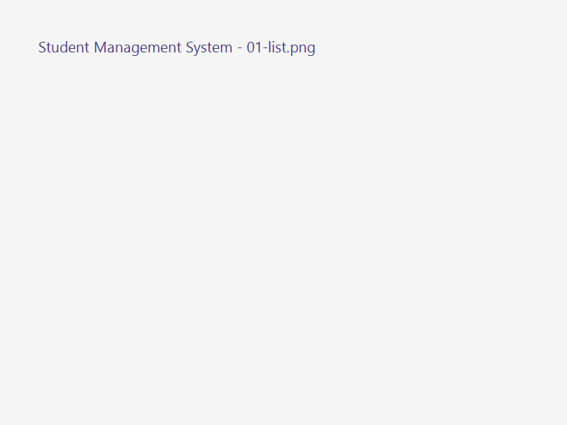
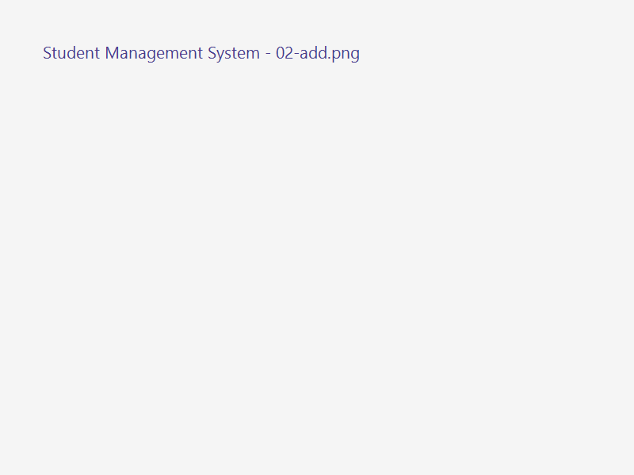
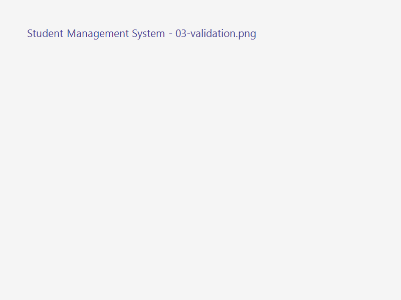
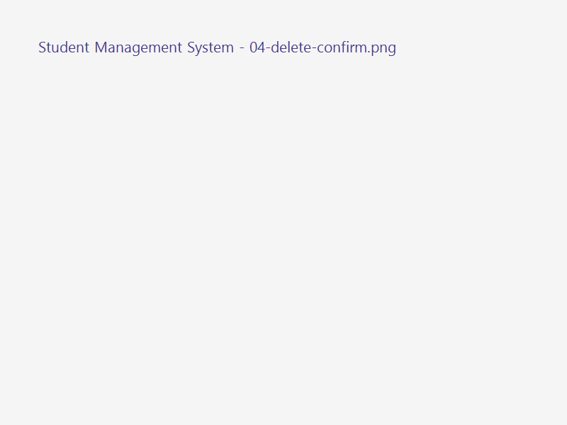

# Student Management System

> Multi-module Maven application built with **JavaFX 21**, **Spring Boot 3.5.x**, and **Spring Data JPA**.

---

## 1. System Requirements & Environment

- **Java Development Kit (JDK):** JDK 21
- **Build Tool:** Apache Maven 3.9+
- **Framework:** Spring Boot 3.5.16
- **UI Framework:** OpenJFX (JavaFX) 21.0.5
- **Runtime Database:** Microsoft SQL Server (StudentDB)
- **Testing Database:** H2 In-Memory Database

---

## 2. Architecture & Project Structure

The project is structured into a clean N-Layer multi-module Maven architecture:

```
student-management/
├── pom.xml                                   (Parent POM, manages dependencies)
├── README.md                                 (Project documentation & guide)
├── docs/
│   └── screenshots/                          (UI execution screenshots)
├── data-module/                              (Data & Business logic layer)
│   ├── pom.xml
│   └── src/
│       ├── main/java/com/example/data/
│       │   ├── pojo/Student.java             (JPA Entity @Entity)
│       │   ├── repository/StudentRepository  (Spring Data JPA Repository)
│       │   ├── exception/                    (Validation & NotFound exceptions)
│       │   └── service/                      (StudentService & StudentServiceImpl)
│       └── test/java/com/example/data/
│           ├── DataTestApplication.java
│           ├── repository/StudentRepositoryTest.java
│           └── service/StudentServiceImplTest.java
└── ui-module/                                (JavaFX User Interface layer)
    ├── pom.xml
    └── src/main/
        ├── java/com/example/
        │   ├── StudentManagementApplication  (@SpringBootApplication)
        │   └── ui/
        │       ├── JavaFxApplication.java    (JavaFX Application lifecycle)
        │       ├── Launcher.java             (Application entry point)
        │       └── controller/StudentController (JavaFX FXML Controller)
        └── resources/
            ├── application.properties        (Database connection config)
            ├── student-view.fxml             (FXML UI Layout)
            └── style.css                     (Custom styling & theme)
```

### Architectural Layering

```
┌────────────────────────── ui-module ──────────────────────────┐
│  student-view.fxml + style.css            (View)              │
│  StudentController  @Component            (Controller)        │
│  JavaFxApplication / Launcher / StudentManagementApplication  │
│  application.properties                   (DB Configuration)  │
└───────────────┬───────────────────────────────────────────────┘
                │ depends only on INTERFACE StudentService
┌───────────────▼─────────── data-module ───────────────────────┐
│  StudentService            (interface)                        │
│  StudentServiceImpl        @Service @Transactional            │
│        │ constructor injection                                │
│  StudentRepository extends JpaRepository<Student, Long>       │
│        │ Spring Data JPA proxy                                │
│  Student  @Entity                                             │
└───────────────┬───────────────────────────────────────────────┘
                ▼
        SQL Server (StudentDB)   |   H2 in-memory (Test)
```

---

## 3. Database Configuration

### 3.1 Create SQL Server Database

Execute the following script in SQL Server Management Studio (SSMS) or `sqlcmd`:

```sql
IF DB_ID('StudentDB') IS NULL CREATE DATABASE StudentDB;
```

Ensure SQL Server is listening on TCP/IP port `1433` and SQL Server Authentication is enabled.

### 3.2 Update Connection Properties

Edit `ui-module/src/main/resources/application.properties` to match your local SQL Server credentials:

```properties
spring.application.name=student-management
spring.main.web-application-type=none

spring.datasource.url=jdbc:sqlserver://localhost:1433;databaseName=StudentDB;encrypt=false;trustServerCertificate=true
spring.datasource.username=sa
spring.datasource.password=12345
spring.datasource.driver-class-name=com.microsoft.sqlserver.jdbc.SQLServerDriver

spring.jpa.hibernate.ddl-auto=update
spring.jpa.show-sql=true
spring.jpa.properties.hibernate.format_sql=true
```

---

## 4. Build, Test, and Run Guides

### 4.1 Build All Modules

From the `slot16/student-management` root directory:

```bash
mvn clean install
```

### 4.2 Run Unit & Integration Tests

Run all tests in `data-module` (uses H2 in-memory database, no SQL Server required):

```bash
mvn -pl data-module test
```

### 4.3 Run Application

Run using Maven:

```bash
mvn -f ui-module/pom.xml spring-boot:run
```

Or execute the entry point class `com.example.ui.Launcher` directly from IntelliJ IDEA / IDE.

---

## 5. Application Screenshots

### 01. Student List & Search
Displays loaded students in the TableView with count status, search bar, and action buttons.


### 02. Add Student
Input fields for student information with primary action buttons.


### 03. Form Validation
Inline validation error messages displayed in red upon invalid inputs.


### 04. Delete Confirmation
Confirmation dialog before removing a student record from the database.


